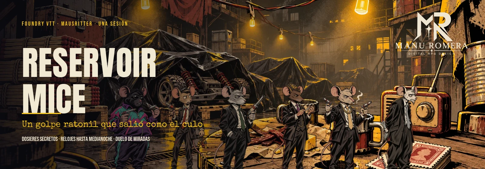
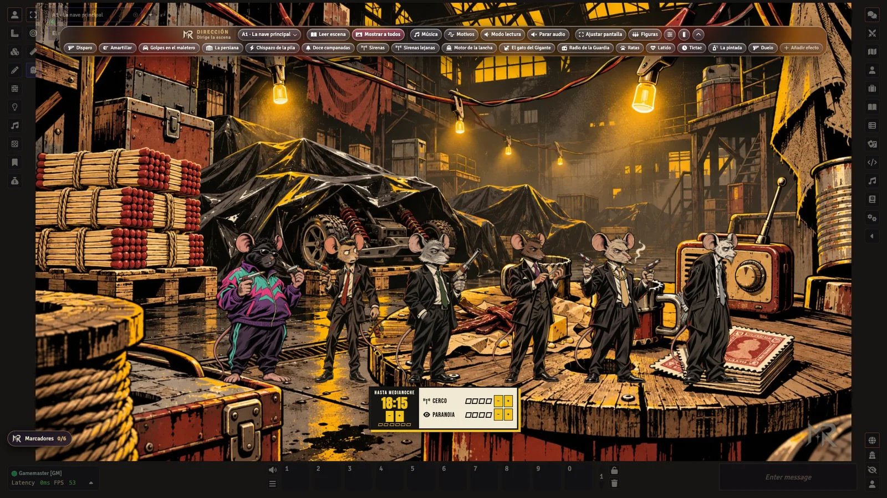
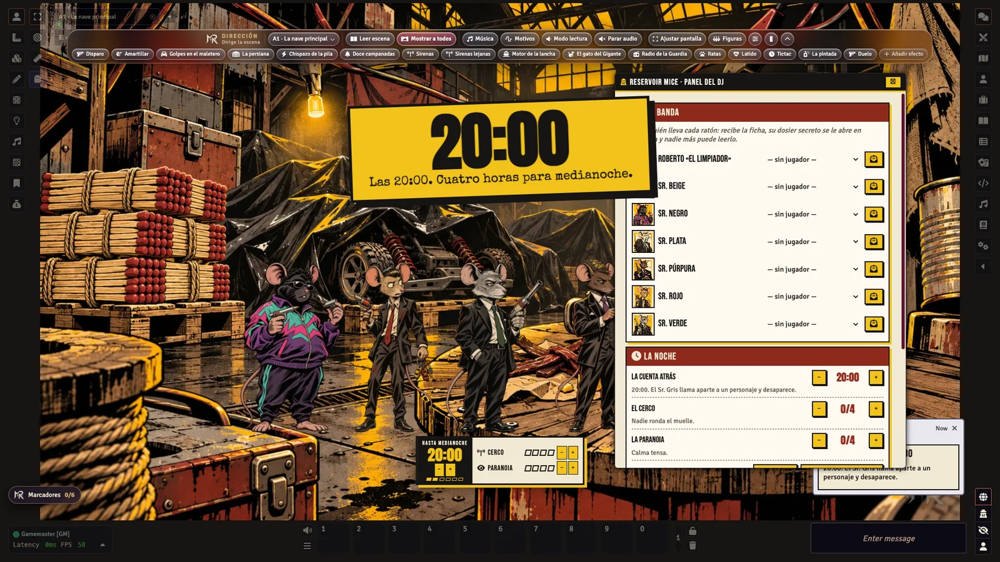

<p align="center">
  
</p>

<p align="center">
  <a href="https://github.com/ManuRomera"></a>
  <a href="https://github.com/ManuRomera/mr-reservoir-mice/releases/latest"></a>
  
  <a href="https://github.com/ManuRomera/mr-reservoir-mice/releases"></a>
  
  
  <a href="LICENSE"></a>
</p>

<h3 align="center">Seis ratones trajeados, cuatro cajas de diamantes y un almacén bajo el embarcadero.<br>Hasta medianoche no llega la lancha. Y uno de ellos lleva placa.</h3>

> [!IMPORTANT]
> **Necesita** el sistema **Mausritter** (`mausritter`, 0.6.1 o superior) en Foundry VTT **v13**.

## La aventura

**Reservoir Mice** es un thriller criminal de olla a presión para una sola sesión de Mausritter, de tres a seis jugadores. El golpe a la Joyería-Relojería del Gigante salió mal: la banda se ha encerrado en una caja de herramientas oxidada bajo el muelle, con un compañero desangrándose, un guardia atado en un maletero y un rastreador escondido en el botín. Hay que aguantar hasta las 00:00. Sin mazmorras ni magia: solo sospechas, mentiras y pistolas de bolígrafo.

<p align="center"></p>

### Lo que la hace distinta

- **Cada jugador tiene un secreto.** Seis dosieres confidenciales: quién eres de verdad, tu objetivo oculto y qué piensas de los demás. Uno de ellos es el infiltrado de la Guardia.
- **La noche se acaba.** Tres relojes a la vista de todos (la hora, el cerco de la Guardia y la paranoia de la banda) empujan hacia el duelo final.
- **Duelo de miradas.** Todos eligen a la vez y en secreto a quién apuntan. Luego se revela y se dispara.
- **La regla del golpe:** seis casillas de inventario. Lo que no cabe, se queda en el coche.
- **Muere tu ratón, sigues jugando.** El primero que cae vuelve como Roberto «El Limpiador», con su propio dosier.

## Qué incluye

| | |
|---|---|
| Escenas | 15 a pantalla completa con miniatura, música y la marca MR animada, más el plano cenital del almacén |
| Actores | 19: los seis ratones, el Limpiador, nueve PNJ y tres vehículos, con el inventario colocado |
| Objetos | 45, con armas, equipo, pistas y las 3 condiciones |
| Diarios | Guía del Narrador por capítulos, dosieres secretos, ayudas de juego y «Cómo se juega en Foundry» |
| Tablas | 3: presión en el muelle, excusas de atracador y escenas postcréditos |
| Audio | 9 temas, 9 motivos, 2 ambientes y 16 efectos, todos propios y en bucle sin corte |
| Macros | 6 |
| Libro | [PDF de 38 páginas](docs/pdf/Reservoir-Mice.pdf) con la aventura, los dosieres y los recortables |

### Herramientas de mesa

El módulo añade un grupo **Reservoir Mice** en la barra de herramientas de la escena.

- **Panel del Narrador:** reparto de personajes (cada jugador recibe su ficha y solo él ve su dosier), relojes, contraseña del barquero, escenas, salvación de nervios, Flashback 1 («¿quién se llevó el tiro?»), duelo de miradas, ayudas de juego y tablas.
- **HUD «Hasta medianoche»** para todos, arrastrable con el botón derecho. Cuando un reloj avanza aparece un rótulo grande con la hora.
- **Jugadores:** botón de salvación de nervios (la condición entra sola en una casilla libre) y elección secreta en el duelo.

<p align="center"></p>

### Integración con MR- Dirección y MR- Pizarra (opcional)

- Con **[MR- Dirección](https://github.com/ManuRomera/mr-direccion)** activo, la aventura se registra sola: escenas con lectura y música, figuras, motivos y efectos de sonido.
- Con **[MR- Pizarra](https://github.com/ManuRomera/mr-pizarra)**, el botón de la chincheta prepara una pizarra de sospechas por capas (la banda, el botín, el maletero, el Sr. Gris y la verdad) que el Narrador va mostrando.

Sin ellos, todo funciona con las herramientas propias del módulo.

### Fichas, efectos y accesibilidad

- **Figuras de cuerpo entero sin fondo**, con opción de ficha redonda en los ajustes del mundo.
- **Efectos de sonido y destellos** en los momentos clave, con volumen propio y desactivables. Los destellos respetan el movimiento reducido.
- **Texto grande y alto contraste** opcionales. Las ventanas recuerdan su posición y caben en cualquier pantalla.

## Instalación

1. En Foundry, **Instalar módulo** y pega el manifiesto:
   ```
   https://github.com/ManuRomera/mr-reservoir-mice/releases/latest/download/module.json
   ```
2. Activa el módulo en un mundo de Mausritter.
3. En un mundo vacío la aventura **se importa sola** al entrar como Narrador. En un mundo con contenido, impórtala desde el compendio.

Los personajes se entregan sin asignar: repártelos desde el panel del Narrador.

## Para quien edita

- El texto vive en `texto/aventura.md` y los datos en `texto/datos.py`.
- `python3 tools/foundry.py` genera `_data/aventura.json` y los paquetes de Dirección y Pizarra. `npm run build` compila el compendio y el zip.
- `python3 tools/arte.py` prepara el arte, `python3 tools/audio.py` sintetiza la música y `python3 tools/libro.py` hace el PDF.
- Las correcciones frente a la edición anterior están en [`docs/CORRECCIONES.md`](docs/CORRECCIONES.md).

## Créditos y licencia

Historia y diseño: Manuel Romera Chinchilla. Módulo, libro, herramientas y revisión del texto y las reglas: Claude, bajo su dirección. Basada en la premisa de *Dockside Dogs*, de Paul Fricker (Chaosium). Imágenes generadas con IA a partir de cuatro imágenes modelo del autor y firmadas con la marca MR. Música y efectos de síntesis propia.

CC BY-NC-SA 4.0. Mausritter es de Losing Games y *Dockside Dogs*, de Chaosium. Es una obra de aficionado y no oficial. Detalles en [NOTICE.md](NOTICE.md).
